<div align="center">

# 🌱 Herdgarden

**A quiet pixel garden for [Herdr](https://herdr.dev).**
Your spaces are homes, your agents are villagers, and the yard shows how the work is going.

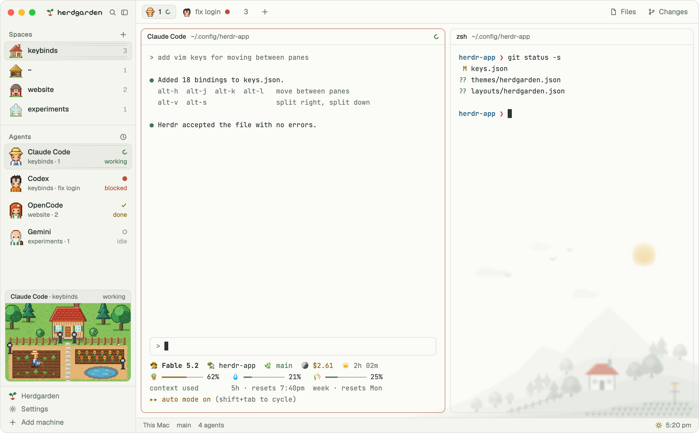

</div>

---

## Your agents, tending the garden

The agent you're looking at gets its own yard in the sidebar. While it works, its villager walks a round of the beds and waters them. When it needs you, they wait on the path with a red **!**. When it's done, they hold a basket of ripe crops. When it's idle, they rest by the flower bed.

<p align="center">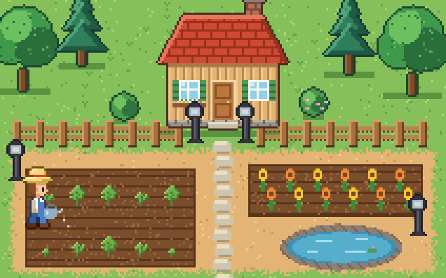</p>

<p align="center">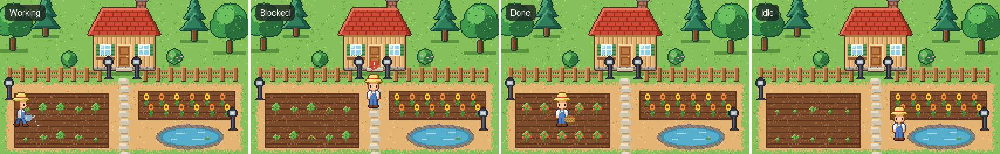<br>
<sub>working · blocked · done · idle</sub></p>

## Four seasons, three times of day

The window follows your clock and your calendar. Dawn comes half an hour before your sunrise, night falls at sunset. In spring the cherry tree blooms; in autumn the leaves fall and pumpkins ripen; in winter the plants go under glass and the villager clears snow instead of watering.

<p align="center">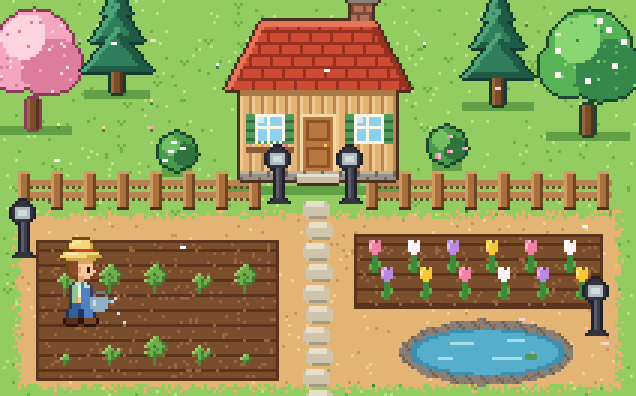</p>

<p align="center">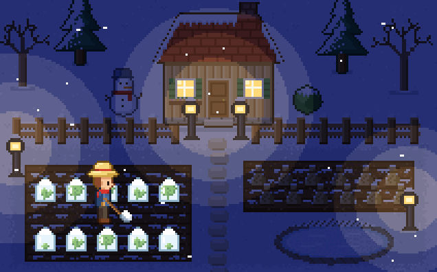</p>

| Spring dawn · Sand | Autumn day · Blossom | Winter night · Paper |
|---|---|---|
| 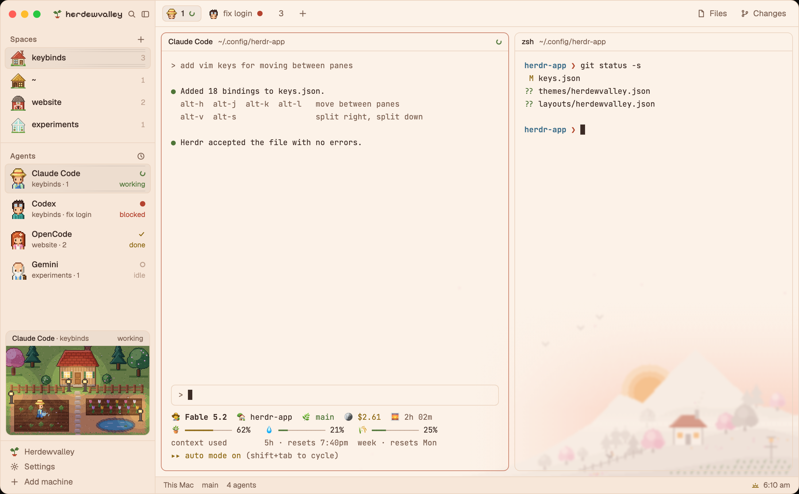 | 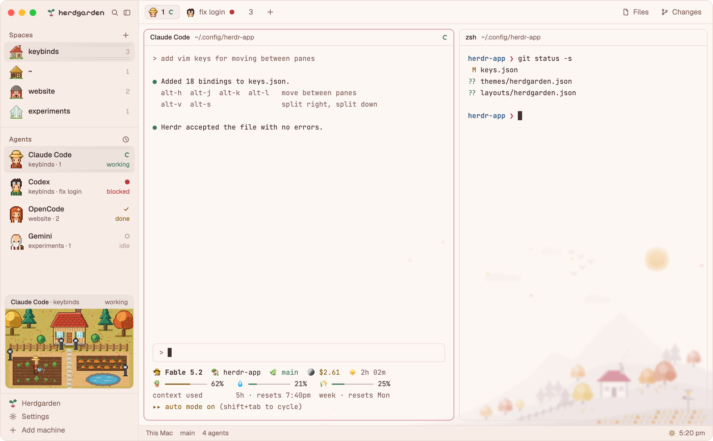 | 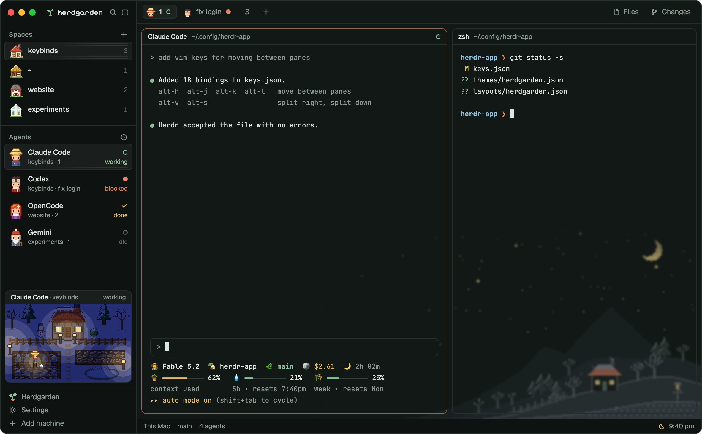 |

## The villagers

One per agent, and they dress for the weather: lighter colors in spring, scarves in autumn, coats and mittens in winter.

<p align="center">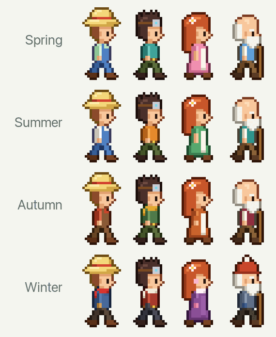</p>

| | Agent |
|---|---|
| 👒 The farmer | Claude Code |
| 🥽 The tinker | Codex |
| 🌸 The gardener | OpenCode |
| 🧔 The elder | Gemini |

Any other agent gets one of the four. A tab with an agent in it shows that villager's face.

## A valley behind your work

A soft pixel valley sits in the bottom-right corner, behind the panes. It's faded and slightly blurred so text stays easy to read, and you can set how strong it is.

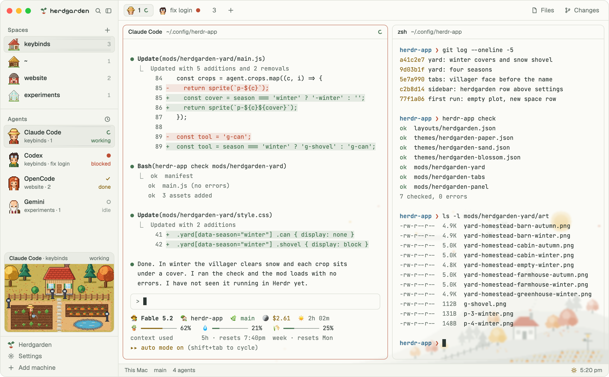

## Settings that stay out of Herdr's way

Herdr's own **Settings** is untouched. The theme's choices live in their own **Herdgarden** row at the bottom of the sidebar:

- **Palette:** Paper (default), Sand, or Blossom
- **Seasons:** follow the calendar, or hold one
- **Time of day:** sunrise and sunset from your time zone, fixed hours, or hold one
- **Background picture:** strength and blur
- **Animations:** on or off

Before your first space, the window shows an empty plot waiting to be built:

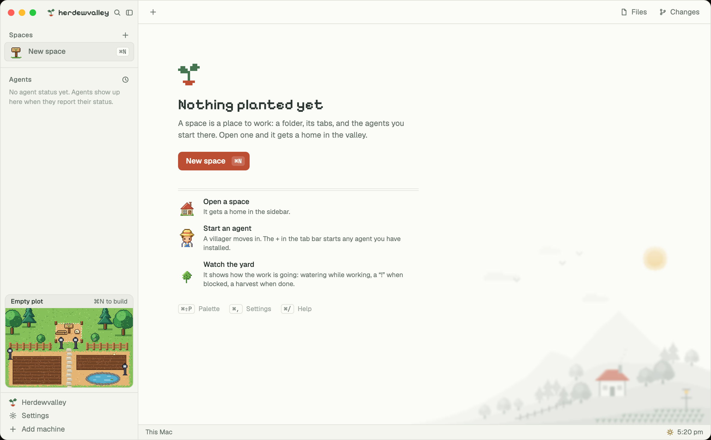

## Install

```sh
git clone https://github.com/svadr/herdgarden.git
cd herdgarden
cp -R layouts themes mods ~/.config/herdr-app/
herdr-app do layout.switch --name herdgarden
```

Or pick **Herdgarden** in Herdr's layout settings. `ctrl-shift-l` cycles back to your other layouts.

**Claude Code:** if you never picked a Claude Code theme, Herdgarden sets it to **Auto** the first time it runs, so Claude's code and file previews stay readable from dawn to night. A theme you chose is left alone, and `/theme` changes it any time. Restart Claude sessions that were already open.

**Needs:** macOS and `python3` (it draws the valley at your window's size). Without Python everything works except the valley picture.

**Reduce Motion:** with macOS Reduce Motion on, Herdr doesn't play timed moves, so the yard switches to a gentler version: the villager faces you and steps along the beds. Turn Reduce Motion off and restart Herdr for the full walk.

### Shortcuts

Hold a look from a key or the terminal:

```sh
herdr-app do herdgarden.night     # or dawn, day, spring, summer, autumn, winter, paper, sand, blossom
herdr-app do herdgarden.auto      # follow the clock and calendar again
```

```json
// ~/.config/herdr-app/keys.json
{ "global": { "cmd-alt-n": "herdgarden.night", "cmd-alt-a": "herdgarden.auto" } }
```

## Extra: a matching Claude Code status line

`extras/claude-code-statusline.sh` is the "Gardener" status line from the screenshots: 🧑‍🌾 model, 🏡 folder, 🌿 branch, 🪙 cost, and raked meters for context and usage. It needs `jq`. In `~/.claude/settings.json`:

```json
{ "statusLine": { "type": "command", "command": "bash /path/to/herdgarden/extras/claude-code-statusline.sh" } }
```

## How it's made

Everything is original pixel art, drawn by small Python scripts in [`mods/herdgarden/tools/art-src`](mods/herdgarden/tools/art-src), with no image editor. [`RECIPE.md`](RECIPE.md) describes the layout in enough detail for an agent to rebuild it from an empty folder. The spaces, agents and tabs lists are Herdr's own shipped mods with small changes.

## License

MIT for the code and art. Pixelify Sans is under the SIL Open Font License.
