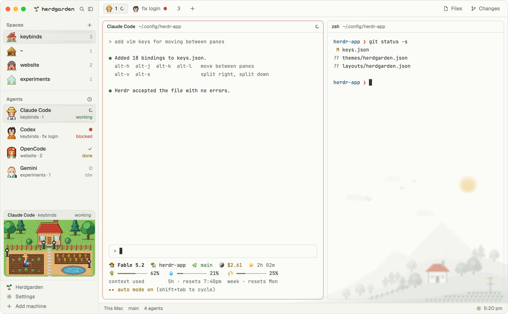

# Herdgarden

A cozy pixel garden for Herdr. Spaces are homes, agents are villagers who water their crops while they work, and the window follows the clock and the seasons.



## What you see

Type is Geist for the UI, the person's terminal font for terminals, and Pixelify Sans (bundled, `mods/herdgarden/fonts/`) for the brand, the empty-state headline, and the panel title. All art is drawn at 1 art pixel and scaled up by whole numbers with nearest-neighbour sampling.

Colors per palette and time of day (canvas, chrome, line, text, muted, dim, accent, working, blocked, done):

| Look | canvas | chrome | line | text | muted | dim | accent | working | blocked | done |
|---|---|---|---|---|---|---|---|---|---|---|
| paper-dawn | `#fbf8f4` | `#f5f1ec` | `#e3ddd6` | `#2f3432` | `#676b68` | `#a3a39d` | `#bc4e34` | `#467552` | `#bc4e34` | `#8a6714` |
| paper-day | `#fbfbf7` | `#f4f5ef` | `#dfe2d9` | `#2b3531` | `#66726b` | `#9aa39c` | `#bc4e34` | `#467552` | `#bc4e34` | `#8a6714` |
| paper-night | `#121816` | `#0e1312` | `#25302b` | `#dde5df` | `#8e9b94` | `#5f6c66` | `#e8866a` | `#8cc29a` | `#e8866a` | `#e3be6a` |
| sand-dawn | `#fcf2e8` | `#f7e7d9` | `#ecd6c3` | `#3c2c26` | `#7d6253` | `#bfa391` | `#b34a30` | `#4f7538` | `#b4432f` | `#8f6a16` |
| sand-day | `#fbf6ee` | `#f4ecdf` | `#e6dac8` | `#3a2e25` | `#7a6853` | `#b3a28e` | `#ad5028` | `#4f7538` | `#b4432f` | `#8f6a16` |
| sand-night | `#1a1612` | `#15110e` | `#332b23` | `#efe5d6` | `#a39480` | `#6f6252` | `#ea9a6e` | `#a9c785` | `#ee8468` | `#e8c273` |
| blossom-dawn | `#fef3f1` | `#fbe6e4` | `#f0d5d3` | `#43302f` | `#876260` | `#c9a5a3` | `#b8445d` | `#3f775a` | `#b93a3a` | `#8c6620` |
| blossom-day | `#fdf7f4` | `#f8ece7` | `#ecdcd5` | `#40302e` | `#836660` | `#bda49d` | `#b8445d` | `#3f775a` | `#b93a3a` | `#8c6620` |
| blossom-night | `#18131a` | `#130f15` | `#2f2633` | `#f1e6ea` | `#a8939f` | `#6e5d69` | `#f08fa4` | `#9fd3b0` | `#f27a8a` | `#efc57c` |

The other theme colors (raised, hover, selected, input, selection, the 16 ANSI colors) are mixed from these in `core.js` `colors()`.

Left to right:

- **Sidebar, 268 px**, on `chrome`, top to bottom:
  - **Brand row, 46 px.** 76 px left free for the macOS traffic lights (at 12, 16). A 15 px pixel sprout, then "herdgarden" in Pixelify Sans 14.5. Search (opens Herdr's `picker`) and the fold button on the right. The row drags the window.
  - **Spaces**, half the remaining height. Herdr's own spaces list, with one change: each space shows a 22 px home (farmhouse, cabin, barn, greenhouse) in place of its colored letter. Rows are 32 px. With no spaces at all, one row reads "New space" with a staked-out lot icon and the `space.new` key (`⌘N`).
  - **Agents**, the other half. Herdr's own agents list (grouped by Needs you, Done, Working, Idle, or by space), with each agent drawn as its villager from the waist up (20 × 25 px) in the current season's clothes. Rows are 34 px. Claude Code is the farmer (straw hat), Codex the tinker (goggles), OpenCode the gardener (red hair, flower), Gemini the elder (white beard). Any other agent gets one of the four by a hash of its name.
  - **Yard, 190 px.** A card (8 px corners, 1 px `border`, `raised` fill) with a 22 px caption (agent name · space, status on the right in its status color) over a 212 × 132 art-pixel picture scaled to the sidebar's width. The picture is the space's home in the middle, a crop bed lower left, a flower bed and a pond lower right, a fence, four lamp posts, and trees. Before any space exists, it is an empty staked-out lot with a signpost, caption "Empty plot" and "⌘N to build".
  - **Foot, 97 px.** Three rows: **Herdgarden** (opens this theme's panel), **Settings** (opens Herdr's own settings, unchanged), **Add machine**.
- **Work column:**
  - **Tab bar, 42 px.** Herdr's own tabs, with one change: a tab with an agent in it shows that villager's face (17 px) before its name. With several agents, the one that most needs you (blocked, then done, then working, then idle).
  - **Panes.** Herdr's pane cards (10 px corners, 1 px border, `accent` when focused, a 30 px `pane` header). `terminal_opacity` is 0 and the pane fill is transparent, so the valley shows through.
  - **The valley**, behind the panes. A 340 × 170 art-pixel picture at 2 picture pixels per art pixel, in the bottom-right corner, faded toward its left and top edges, at 65% strength with a 1.5 px blur by default. Tinted to the palette, one per palette, time of day, and season.
  - **Status bar, 28 px.** Herdr's own (machine, branch, agent count, the palette key), plus a sun, sunrise, or moon icon and the clock on the right.
- **Before any space exists**, the panes area shows instead: the sprout (36 px), "Nothing planted yet" (Pixelify Sans 25), one line on what a space is, a "New space ⌘N" button in `accent`, three steps (Open a space / Start an agent / Watch the yard) with art, and the Palette, Settings and Help keys.

The **Herdgarden panel** (a 268 px popup, as tall as the window allows, scrolls past that): palette swatches (Paper, Sand, Blossom), "Follow the seasons" (or pick one), "Follow the time of day" with Sunrise and sunset or Fixed hours (or pick one), background picture strength (40, 55, 65, 80, 100%) and blur (off, 1, 1.5, 2, 3), Animations on or off, and **Claude Code status line** (off until switched on; the line under it reads "Shows Gardener in ~/.claude/settings.json." when off and "Gardener. Off puts your old one back." when on).

## How it behaves

| Status | Yard | Sidebar and tabs |
|---|---|---|
| working | the villager walks a round of both beds, stops at each to water (in winter: clears snow with a shovel), and stops by the pond | Herdr's spinner in `working` |
| blocked | the villager stands on the path below the door with a blinking red "!"; two crops wilt | `blocked` dot, "Needs you" |
| done | the villager stands by ripe crops (red fruit) holding a harvest basket | `done` dot |
| idle | the villager rests by the flower bed, "z z" | a ring in `dim` |

- **Which yard.** The focused agent's; else the most urgent agent in the shown tab; else in the shown space. Clicking the yard focuses that agent's pane.
- **Time of day.** Dawn runs from 30 minutes before sunrise to 90 minutes after it, day until sunset, night after. Sunrise and sunset are worked out from the system time zone's rough latitude and longitude (no location is asked for), or fixed hours (5:30, 8:00, 18:00) when the person picks them. At dawn and night the yard darkens, the lamps and windows glow, and the villager carries a soft light. At night fireflies blink in spring and summer.
- **Seasons.** From 20 March, 21 June, 22 September, and 21 December, swapped south of the equator. Spring: cherry blossom, tulips, seedlings, petals in the air, lighter clothes. Summer: the original pictures. Autumn: orange and gold trees, pumpkins, falling leaves, a full moon, warm clothes and scarves. Winter: snow, bare trees, a frozen pond, a snowman, crops under glass covers, the flower bed in burlap, coats, mittens, and a wool hat for the elder.
- **The round.** About 81 s, at one walking speed (8.6 art px a second), so each leg's time comes from its length. Along the aisle above the first row of crops, stopping once to water; down the bed's edge by the path; along the aisle below the second row, stopping to water, out to the far end; back along that aisle and up the edge; across the path to the flower bed, stopping to water; on to the far end and back; down to the pond, stand 4 s, up again; back along the top aisle to the start. The route is a list of walks and stops in `yard.js` (`ROUTE`), relative to the crop bed's corner.
- **Which way they face.** Walking across, side-on (a 4-frame walk cycle at 215 ms a frame: one leg leads, the legs pass, the other leg leads, they pass; the body bobs one pixel between steps), mirrored when walking left. Walking down, the front, with the tool hanging at their side. Walking up, the back (the back of the hat or hair). Standing, side-on, facing the way they last walked across. The watering can pours, or the shovel scoops, only where the route says the tool is in use.
- **Depth.** The first row of crops is always behind the villager. The second row is in front of them, except while they are in the lower aisle or on a leg that starts or ends there; then it is behind them too.
- **Reduce Motion.** When macOS Reduce Motion is on, Herdr does not play timed moves or animated pictures. The yard then switches (checked every minute) to loops only: the villager faces you and works along the beds and back over 40 s, stepping in place (two frames, 560 ms); what falls rides large slow wheels (`spin`) so it still falls one way.
- **Animations off** (panel): everything stands still; the falling things become a still picture.
- **Keys and commands.** `herdgarden.dawn`, `.day`, `.night`, `.spring`, `.summer`, `.autumn`, `.winter`, `.paper`, `.sand`, `.blossom` hold that choice; `herdgarden.auto` follows the clock and calendar again. Use them from `keys.json` or `herdr-app do herdgarden.night`. `herdr-app do mod.open --name herdgarden` opens the panel.
- **Homes.** A space gets the kind of home used least when it first appears, and keeps it (shared `hv.homes`).

## Built from

Layout `layouts/herdgarden.json`: Herdr's `main` tree, with these changes. Every sidebar and bar block uses this one mod, told apart by `props.role`. A `yard` block is added to the sidebar. The panes block is wrapped in a `stage` stack with an `empty` block.

```
root (row, titlebar none, traffic_lights [12,16], theme "herdgarden", terminal_opacity 0, preview layouts/herdgarden.png)
├─ sidebar (column, 268 px, min 44, max 480, not resizable, chrome)
│  ├─ brand        block 46 px, window_drag      role: brand
│  ├─ sidebar-lists (column)
│  │  ├─ spaces    block weight 1, min 90        role: spaces
│  │  └─ agents    block weight 1, min 90        role: agents
│  ├─ yard         block 190 px                  role: yard
│  └─ sidebar-footer block 97 px                 role: footer
└─ work (column)
   ├─ tabs         block 42 px, window_drag      role: tabs
   ├─ work-body (row, padding 8, gap 8)
   │  ├─ stage (stack: main | empty)             background: the valley picture, written by the mod
   │  │  ├─ main   { tab: "active", pane: { gap 8, radius 10, background "#00000000", lone, border, focus accent, header: mod "pane" 30 px } }
   │  │  └─ empty  block                          role: empty
   │  └─ panel (Herdr's Files and Changes stack, hidden)
   └─ status       block 28 px                    role: status
```

Theme `themes/herdgarden.json`: Paper by day, so the window looks right before the mod first runs.

Mod `mods/herdgarden/` (`mod.json`: `place: "none"`, and an `overlay` of kind `dialog` 292 px wide, so `mod.open` shows the panel):

| File | Role | What it does |
|---|---|---|
| `main.js` | | maps `props.role` to a class; no role with an overlay is the panel |
| `core.js` | | the person's choices (shared `hv.config`), sunrise and sunset, season, the color table, villager and home lookups, key hints |
| `look.js` | | applies the look: `layout.set` with root `colors` and the `stage` background; runs `tools/bg.py` to draw the valley at the stage's size into `bg/` |
| `chrome.js` | brand, footer | the brand row, the foot with the Herdgarden row; folding hides the yard |
| `spaces.js` | spaces | Herdr's `spaces` mod with homes and the first-run row |
| `agents.js` | agents | Herdr's `agents` mod with villagers; also its sort popup |
| `tabs.js` | tabs | Herdr's `tabs` mod with villager faces |
| `status.js` | status | the status bar and clock; notices look or size changes and wakes `look.js`; reads the time zone; takes the `herdgarden.*` commands; runs `claude.js` once at start; publishes the shown palette, time of day and season as shared `hv.now` |
| `claude.js` | | sets Claude Code's theme to `auto` in `~/.claude/settings.json` when the person never chose one, so its own colors follow light and dark; result in shared `hv.claude` |
| | | also turns the Gardener status line (`tools/statusline.py`) on or off as `statusLine`, only when the panel's switch says so (shared `hv.config.claudeLine`); turning it on keeps the replaced line in `data/herdgarden/claude-statusline-before.json`, turning it off puts that one back; result in shared `hv.claude.statusline` |
| `tools/statusline.py` | | the Gardener status line: three lines from Claude Code's JSON on stdin, in the 16 ANSI colors so it follows the theme; the sky is `hv.now.tod` from `shared.json`, else fixed hours (dawn 5:30, day 8:00, night 18:00) |
| `yard.js` | yard | the yard, both motion modes |
| `empty.js` | empty | the first-run screen |
| `panel.js` | panel | the Herdgarden panel |
| `tools/bg.py` | | draws the valley picture (Python 3 standard library) |
| `tools/art-src/` | | the scripts that draw every picture, and the design preview page |

Herdr functions used: `spaces`, `agents`, `panes`, `terminals`, `focused`, `machines`, `layout`, `theme`, `settings`, `keys`, `window`, `shared`, `setShared`, `run`, `exec`, `hc`, `openOverlay`, `closeOverlay`, `nextCommand`, `setAgentOrder`, `watchFolder`, `appHome`, `home`, `readTextFile`, `writeTextFile`, `notify`, `updates`, and `fs/promises` (`exists`, `readdir`, `unlink`). Commands: `layout.set`, `layout.select`, `layout.show`, `layout.hide`, `layout.resize`, `space.new`, `space.select`, `space.move`, `tab.*`, `pane.focus`, `terminal.pin`, `terminal.peek`, `mod.open`, `app.settings`, `app.palette`, `window.minimize`, `window.maximize`, `window.close`.

Programs it runs, all local: `python3 tools/bg.py` (draws the valley), `readlink /etc/localtime` (the time zone's name), `defaults read com.apple.universalaccess reduceMotion`, and `git` (Herdr's spaces list, unchanged). No network. Claude Code, not the mod, runs `tools/statusline.py`.

It writes to its own folder (`bg/`), to shared state, to `themes/herdgarden.json` (the terminal colors for each look), and to `data/herdgarden/claude-statusline-before.json`. Outside the Herdr folder it writes only `~/.claude/settings.json`: `theme` once, when the person never chose one, and `statusLine` only when the panel's switch is flipped.

Art, all original, in `mods/herdgarden/art/`:

| Folder | What | Drawn at |
|---|---|---|
| `yard/<home>-<season>-<tod>.png` | the yard with the light baked in; homes plus `empty` | 212 × 132, saved at 4× |
| `villager/<who>-<season>{,-bust,-face,-step,-stand-l,-stand-r,-front-stand,-back-stand}.png`, `-walk-l.webp`, `-walk-r.webp`, `-walk-down.webp`, `-walk-up.webp` | 4 villagers × 4 seasons; the back view replaces the face with the back of the head, and the front and back walks lift one foot, then the other | 16 × 32, 6× (walks 4×) |
| `crop/`, `tool/`, `home/` | crops (and winter covers), can, shovel, basket, "!", light halo, sidebar homes | 6× |
| `weather/<season>.webp` / `.png` / `-<n>.svg` | falling things: a looping picture, a still, and the wheels for Reduce Motion | |
| `scene/<palette>-<tod>-<season>.bin` | the valley: `HVS1`, width, height, palette size (little-endian u16), RGB palette, one index byte per pixel | 340 × 170 |

`python3 tools/art-src/export_herdr.py mods/herdgarden/art` redraws all of it (needs `img2webp`); `weather_wheel.py` draws the wheels.

## Watch out

- **Reduce Motion.** With macOS Reduce Motion on, `.transition()` jumps straight to its target and animated WebP or GIF pictures stay on their first frame; `.loop()` and `.spin()` still run. The yard has a loop-only mode for this. Herdr appears to read the setting when it starts, so after changing it, restart Herdr.
- A `.transition()` whose duration is a fraction of a millisecond is dropped: round it.
- A `.loop()` period over 86,400,000 ms makes the whole view fail to render. All loops share one clock, so they cannot be started at a chosen phase, and they only swing there and back.
- `on_size_change` and `window.viewport_size()` report window pixels; divide by `settings().zoom` to get layout pixels.
- A layout background only scales to cover its node and cannot animate. The valley is drawn at the node's exact size, so it is redrawn when the window, the side panel, or the sidebar changes size. Drawing it in the mod's own JavaScript stalls silently, which is why it is a Python script.
- `layout.set` cannot run inside a render. Read the layout and write it in the same tick, and only when the look really changed.
- A terminal's plain text and cursor come only from the theme file, not from the layout's `colors`, so `look.js` rewrites `themes/herdgarden.json` with every look. Without that, night shows dark text on a dark window.
- Terminal programs that pick their own colors ignore the theme. Claude Code on its default dark theme paints file previews and code near-white, which vanishes at dawn and day; its `auto` theme asks the terminal for its background and follows each switch, so `claude.js` sets it once. A theme the person chose (in `~/.claude/settings.json`, or other than `dark` in the older `~/.claude.json`) is left alone. Claude Code sessions already running keep their colors until restarted. Scrollback printed before a switch keeps its old colors.
- Never set Claude Code's `statusLine` on your own. The person may already have one. An earlier build replaced it on the first start; the switch exists so nothing changes until the person flips it, and so their old line comes back when they flip it off.
- `spaces.js`, `agents.js` and `tabs.js` are copies of Herdr 0.1.15's shipped mods with small changes; a newer Herdr may change the originals.
- Assumes macOS (traffic lights, `defaults`, `/etc/localtime`) and `python3` on the PATH. Without Python, everything works except the valley picture, and shared `hv.error` says why.

## Done when

- `herdr-app check mods/herdgarden` passes and `layout.switch {"name":"herdgarden"}` shows the window with no errors in `herdr-app status`.
- The sidebar shows a home per space, a villager per agent, and the yard for the focused agent; tabs with an agent show its face.
- The valley sits behind the panes in the bottom-right corner, and `layout()` shows a `stage` background under `mods/herdgarden/bg/`.
- `herdr-app do herdgarden.night` turns the window dark within a second, the yard's lamps light, and the valley shows the moon; `herdgarden.winter` puts snow in the yard and coats on the villagers; `herdgarden.auto` goes back.
- With an agent working (and Reduce Motion off), the villager walks side-on along the top aisle, walks down the bed's edge showing their front, works the lower aisle with the second row of crops behind them, and walks back up showing their back. Their legs visibly step on every frame of a walk, and they stop to water. Blocked shows the "!", done shows the basket, idle shows "z z".
- With every space closed, the panes area reads "Nothing planted yet" and the yard is the empty lot.
- The Herdgarden row opens the panel with every row visible; Settings opens Herdr's own settings.
- With no `theme` in `~/.claude/settings.json`, the first start adds `"theme": "auto"` and nothing else, shows a toast, and shared `hv.claude` reads `set`; on later starts, or with a theme already chosen, it reads `already-set` and the file is unchanged. `herdgarden.night` then `herdgarden.day` writes `themes/herdgarden.json` with the matching `foreground` and `background`.
- With `hv.config.claudeLine` unset, the first start leaves `~/.claude/settings.json` alone and sets `claudeLine` to whether the Gardener line is already there. Switching **Claude Code status line** on in the panel sets `statusLine` to `python3 '<home>/mods/herdgarden/tools/statusline.py'` with `padding: 0`, saves the earlier `statusLine` to `data/herdgarden/claude-statusline-before.json`, and shared `hv.claude.statusline` reads `set`. Switching it off restores that line (or removes `statusLine` if there was none) and reads `restored` or `removed`. Piping `{"context_window":{"used_percentage":25}}` to the script prints a second line with 🌿 and 3 of 10 meter cells filled.
